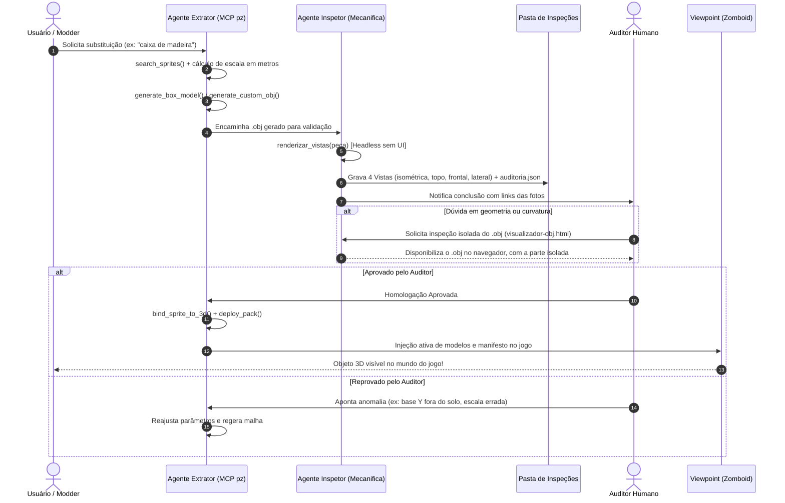

# 🚀 Skill: Esteira de Inspeção Visual e Auditoria 3D (Project Zomboid B42)

Esta skill documenta o **runbook operacional completo de ponta a ponta** para converter sprites 2D isométricos do Project Zomboid Build 42 em modelos 3D poligonais físicos (`.obj` + `.mtl`) totalmente auditados e integrados ao mod de Primeira Pessoa (*Viewpoint*).

A esteira opera com separação estrita de responsabilidades entre duas trilhas paralelas:
1. **Esteira Técnica de Modelagem:** Executada pelo [Agente Extrator 3D](file:///c:/Users/micro/Desktop/ProjectZomboid-FirstPerson-Suite/.agents/extrator-3d.md) utilizando as ferramentas do MCP `pz-model-extractor`.
2. **Esteira de Inspeção Visual e Auditoria:** Executada pelo [Agente Inspetor Visual](file:///c:/Users/micro/Desktop/ProjectZomboid-FirstPerson-Suite/.agents/inspetor-visual.md) (renderização headless via MCP `mecanifica`) e homologada pelo [Auditor Humano](file:///c:/Users/micro/Desktop/ProjectZomboid-FirstPerson-Suite/.agents/auditor-humano.md).

---

## 🎯 Por que Substituir Sprites por Modelos 3D Reais?

No Project Zomboid tradicional (visão isométrica fixa), o jogo desenha a maior parte dos móveis e recipientes como **sprites 2D achatados**.

Quando o jogador ativa a visão em Primeira Pessoa (*Viewpoint*):
* Os sprites 2D comportam-se como **"folhas de papelão" ou papéis de parede planos (billboards)**: ao andar ao redor do objeto, ele parece uma lâmina sem profundidade ou gira distorcendo com a câmera.
* Os shaders customizados da suíte (`bleak-horror`, `photorealism`) dependem de vetores de normais para calcular iluminação volumétrica, sombras projetadas e oclusão de ambiente (SSAO). Sprites 2D não oferecem dados geométricos ao motor gráfico.
* Modelos 3D `.obj` com materiais `.mtl` conferem massa volumétrica real, oclusão física e imersão absoluta para combate e exploração em FPS.

---

## 🏗️ Diagrama de Fluxo Ponta a Ponta



---

## 📋 Passo a Passo Operacional (Runbook)

### Passo 1: Descoberta e Catalogação do Sprite Alvo
Antes de modelar, identifique o identificador de sprite usado internamente pelo Zomboid.

1. Chame o diagnóstico para verificar a saúde dos caminhos:
   ```python
   # Via ferramenta MCP: get_diagnostics
   ```
2. Pesquise o sprite desejado:
   ```python
   # Via ferramenta MCP: search_sprites(query="crate", max_results=10)
   # Retorno esperado: furniture_storage_01_16 ("Wooden Crate Simple")
   ```
3. Verifique se o objeto já possui modelo pré-existente ou extraído vanilla:
   ```python
   # list_ready_models() ou list_vanilla_extracted()
   ```

### Passo 2: Geração da Geometria 3D no Pacote de Staging
1. Crie o pacote de trabalho se ainda não existir:
   ```python
   # create_model_pack(pack_id="zomboid-essentials", pack_name="Zomboid 3D Essentials")
   ```
2. Gere a malha geométrica respeitando a convenção de **1 tile = 1 metro** e base inferior em `Y = 0.00m`:
   * Para caixas, cubos e prismas paramétricos:
     ```python
     # generate_box_model(
     #   pack_id="zomboid-essentials",
     #   model_name="wooden_crate_01",
     #   width=0.85, height=0.85, depth=0.85,
     #   texture_name="crate_diffuse.png"
     # )
     ```
   * Para geometrias complexas ou malhas customizadas:
     ```python
     # generate_custom_obj(pack_id="zomboid-essentials", model_name="chair_01", obj_content=raw_obj)
     ```

### Passo 3: Renderização Headless e Inspeção Visual (Agente Inspetor)
**REGRA DE OURO:** Nenhum modelo vai para o jogo sem antes passar pela renderização headless.

1. O Inspetor Visual aciona o renderizador headless via Mecanifica:
   ```python
   # mecanifica:renderizar_vistas(peca="wooden_crate_01")
   ```
2. Os artefatos são gravados estruturados no diretório:
   `05-Model-3D-Extractor-MCP/objetos-extraidos-vanilla/inspecoes/wooden_crate_01/`
   * `vista_isometrica.png`: Iluminação dinâmica, cantos e oclusão de ambiente.
   * `vista_topo.png`: Alinhamento do footprint no quadrado de 1m x 1m.
   * `vista_frontal.png`: Verificação da base no solo (`Y=0`) e altura total.
   * `vista_lateral.png`: Verificação de profundidade e proporção.
   * `auditoria.json`: Metadados com dimensões calculadas e contagem de faces.
   * `relatorio_inspecao.md`: Checklist descritivo preenchido pelo inspetor.

### Passo 4: Auditoria Humana (Inspeção das Fotos)
O operador humano abre as imagens na pasta de inspeção e analisa os 5 pilares do [Protocolo de Auditoria Humana](file:///c:/Users/micro/Desktop/ProjectZomboid-FirstPerson-Suite/.agents/auditor-humano.md):

| Pilar | O que verificar | Critério de Reprovação |
| :--- | :--- | :--- |
| **1. Volumetria** | O objeto preenche o espaço 3D? | Parece placa de papelão plana. |
| **2. Escala** | Medidas reais coerentes com o sobrevivente? | Caixa maior que um carro ou porta de 1m de altura. |
| **3. Normais** | Faces uniformemente iluminadas? | Faces pretas ou iluminação pelo lado de dentro. |
| **4. Texturas** | Orientação correta e sem esticamentos? | Rótulos invertidos ou nós de madeira esticados. |
| **5. Solo (Y=0)** | Toca o piso na linha Y=0? | Flutuando no ar ou afundado no piso. |

### Passo 5: Inspeção Isolada de um `.obj` (Se Houver Dúvida)
Se o auditor suspeitar de imperfeições que não ficam claras em 2D, use o visualizador de OBJ do repositório Mecanifica (`src/visualizador-obj/`). Ele lê o `.obj` direto, sem receita, e isola uma parte pelo material (`usemtl`), que é como os modelos do jogo estão organizados (uma parte por material, um objeto por arquivo).

1. Com o servidor de desenvolvimento do Mecanifica rodando (`npm run dev`), abra no navegador:
   ```text
   http://localhost:5173/nos-mecanifica/visualizador-obj.html?obj=<caminho do .obj relativo ao repositório Mecanifica>&selecionadas=<material da parte>&modo=isolar
   ```
   O caminho precisa estar dentro do repositório Mecanifica, porque o servidor só serve arquivos de lá. Copie o `.obj` para uma pasta ignorada, como `tmp/`, antes de abrir.
2. No painel, a lista mostra cada parte e o estado dela (`normal` ou `oculto`). Sem `selecionadas`, todas aparecem.

O `ativar:bancada` do Mecanifica não serve para isto: ele só carrega receita `.js` do próprio Mecanifica, não um `.obj`.

### Passo 6: Amarração do Sprite e Deploy no Viewpoint
Após a homologação expressa do Auditor Humano:
1. Faça o bind do sprite para a geometria 3D:
   ```python
   # bind_sprite_to_3d(
   #   pack_id="zomboid-essentials",
   #   sprite_name="furniture_storage_01_16",
   #   model_name="wooden_crate_01",
   #   rotation_degrees=0.0,
   #   offset_x=0.0, offset_y=0.0, offset_z=0.0,
   #   scale=1.0
   # )
   ```
2. Execute o deploy do pacote no jogo:
   ```python
   # deploy_pack(pack_id="zomboid-essentials")
   # ou deploy_ready_pack() para o pacote mestre
   ```
3. O script injeta o carregador dinâmico `media/lua/client/Viewpoint_AutoRegisterPacks.lua` na pasta do mod.
4. Ao abrir o jogo ou usar o hot-reload, a caixa de madeira 2D é imediatamente substituída pelo modelo 3D físico!

---

## 🛠️ Matriz de Comandos Rápidos

| Ação | Ferramenta MCP | Agente Responsável |
| :--- | :--- | :--- |
| Diagnosticar caminhos e packs | `pz-model-extractor:get_diagnostics` | Extrator 3D |
| Pesquisar sprites por texto | `pz-model-extractor:search_sprites` | Extrator 3D |
| Criar modelo 3D de caixa | `pz-model-extractor:generate_box_model` | Extrator 3D |
| Injetar malha 3D customizada | `pz-model-extractor:generate_custom_obj` | Extrator 3D |
| Renderizar 4 vistas headless | `mecanifica:renderizar_vistas` | Inspetor Visual |
| Descrever geometria e volume | `mecanifica:descrever_peca` | Inspetor Visual |
| Inspecionar e isolar um `.obj` | visualizador de OBJ do Mecanifica (`visualizador-obj.html`) | Inspetor / Auditor |
| Amarrar sprite ao modelo 3D | `pz-model-extractor:bind_sprite_to_3d` | Extrator 3D |
| Fazer deploy no jogo ativo | `pz-model-extractor:deploy_pack` | Extrator 3D |
